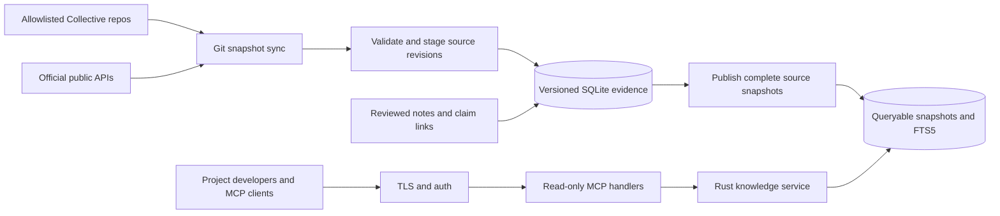

# Cassandra-Viam-MCP architecture

**Status:** Proposed for implementation · **Date:** 2026-11-08

Cassandra-Viam-MCP gives Cassandra Collective projects a shared research memory. It connects versioned public research to the Collective's decisions, hypotheses, and experiment results so engineers and their agents can ask what changed, how a result was obtained, and whether it applies to their project. Mimir is the server name used in the original design.

The first release is a read-only knowledge service. Its coverage includes LLM architecture, training algorithms and optimization, pretraining, post-training, evaluation and agent harnesses, and relevant AI, machine learning, and data science methods. Cassandra model inference and tool use are later integrations. The [requirements and build plan](docs/specification.md) defines the first release and its acceptance gates. The [AI But Simple investigation](docs/research/ai-but-simple.md) records the public behavior that informed the design.

## Decisions

| Area | Design |
| --- | --- |
| Runtime | Rust with `tokio`, `axum`, `rmcp`, `schemars`, `serde`, and `tracing`. Pin the Rust toolchain, SDK version, and supported client protocol revisions after the compatibility spike. |
| Persistence | `rusqlite` with SQLite and FTS5 on a single host. Keep versioned evidence and published snapshots in normalized tables. FTS5 is a rebuildable projection. |
| Delivery | Stateless Streamable HTTP over HTTPS for shared access. Stdio may serve as a local development and contract-test transport. |
| Sources | Allowlisted GitHub repos for Collective evidence, arXiv for research discovery, and selected GitHub releases for implementation changes. Add opt-in adapters as coverage needs become measurable. |
| Ranking | Apply visibility, scope, and status filters first. Rank lexical relevance, then use explicit versioned preferences for freshness or evidence strength. Popularity is discovery metadata. |
| Trust | Every factual result points to source versions and locators. Editorial notes, author claims, internal runs, and independent reproductions have separate identities and review states. |
| Deployment | Begin with one Linux host, one writer, Caddy for TLS, and a service manager. Select the hosting provider after capacity and cost verification. |

## Components and data flow

- **Sync worker.** A scheduler claims a per-source lease and acquires a bounded refresh window. Adapters fetch allowlisted data and stage records with provenance and parse diagnostics. A GitHub webhook can enqueue a refresh after signature verification. Periodic reconciliation covers missed webhooks.
- **Publisher.** After a complete bounded run, one transaction makes the source snapshot visible, updates its FTS projection and successful watermark, and records its source coverage. A new revision creates an immutable version. A failed run keeps the previous published state readable. Any staging cursor is separate from the published watermark.
- **Review workflow.** A reviewer adds a technique note, links claims to evidence, or corrects a relation through versioned review inputs. A discovered item can appear immediately as a candidate. A reviewed summary requires a reviewer, review time, version, and evidence links. Source changes can invalidate those links and queue the summary for re-review.
- **Knowledge service.** Pure Rust query and comparison logic owns evidence selection, scope, pagination, and time semantics. It reads a consistent snapshot per call and hands typed results to the MCP adapter. It can be tested against a fixture database without a host or model.
- **MCP adapter.** Declares the supported tool schemas and validates input and access before querying. It emits structured results and a JSON text fallback for clients that need it. It never fetches user-supplied URLs on behalf of a tool call.

### Sources and identity

Collective sources use `owner/repo`, configured ref, resolved commit, file path, and section or line range. Fetch into a managed mirror, then parse the immutable Git tree for the resolved commit and approved paths. Track deleted or renamed paths on subsequent snapshots. Keep internal evidence in its configured access scope.

External sources use provider-native IDs, version identifiers where available, retrieval timestamps, content digests, and canonical URLs. For an editable release or card without an immutable URL, retain the provider ID, observed revision, and a rights-permitted snapshot or digest. A paper and a linked implementation remain separate records. Link them with an explicit relation. Merge cross-provider duplicates only on a verified ID match or reviewed mapping.

| Record | Stable data and relationships |
| --- | --- |
| `Source` and `SyncRun` | Source ID, adapter and watch configuration, access scope, attempt and completion times, coverage, cursor, errors, and published snapshot ID. |
| `Work` and `SourceRevision` | Stable entity ID, type, provider aliases, immutable revision ID, canonical and version URLs, source dates, discovery time, digest, license decision, visibility, and supersession or withdrawal state. |
| `Claim` and `EvidenceLink` | Bounded statement, setup and applicability, evidence type, immutable revision and locator, relation (`supports`, `contradicts`, `qualifies`), and review history. |
| `Technique` and `ProjectDecision` | Curated explanations and Collective ADRs with versioned links to claims, implementations, datasets, evaluations, hypotheses, and experiment stages. |
| `Publication` | Queryable snapshot ID and admission time, constituent source generations, index schema and ranking versions, and per-source freshness state. |

Dates are separate fields. `published_at` and `source_updated_at` describe the source. `discovered_at` and `admitted_at` describe ingestion and publication by Viam. `reviewed_at` describes human review. `as_of` selects the most recent eligible Viam publication at or before the requested UTC time. Older evidence outside the retained publication window returns an explicit coverage error. A later discovery about older work enters the timeline when Viam admitted it.

### Serving freshness and corrections

Each source has its own poll interval, maximum acceptable age, and bounded scope. A scoped read carries the published generation, `as_of`, and health of the sources it used. A recent success means the configured window was checked successfully. It does not imply global coverage of a field or verification of every discovered claim.

When an adapter fails, retain its last good snapshot and distinguish `stale`, `unavailable`, and `partial` coverage from a successful empty result. Report both the snapshot's coverage and the latest known refresh status for current reads. Historical reads report coverage recorded for the selected publication. A retraction or superseding revision records a new state, retains historical evidence, and makes affected claims ineligible for current recommendations until review. Explicit history reads can still retrieve superseded versions with their status. Access revocation and license removal are enforced against current policy even for historical queries.

### Search and comparison

Use FTS5 to find candidates across allowed titles, aliases, metadata, and approved excerpts. Index by revision and filter through publication membership so current and retained historical queries can resolve different versions. Resolve topic, date, project, artifact type, and evidence filters in SQL. Rank with versioned features such as title, alias, and term matches whose scores stay fixed for a publication, then break ties by stable ID. An opaque cursor binds the publication, query, and authorization scope. Use a versioned, deterministic policy for the weekly digest and include the reason each item qualified. [SQLite FTS5](https://sqlite.org/fts5.html)

`compare_methods` aligns results on evaluation protocol, model and size, dataset and split, metric and direction, budget, baseline, and harness version when those dimensions apply. Report missing context or incompatible measurements explicitly. A new paper may qualify a Collective decision through a reviewed relationship. It cannot overwrite an internal result or change the decision automatically.

## Protocol and deployment

Use the official Rust MCP SDK and test the supported protocol versions against actual clients. The July 2026 protocol uses per-request metadata and server discovery. Older clients may require the legacy initialization flow. Keep wire compatibility separate from the version of the Viam result schema. Capability claims for individual Codex, Claude, and Gemini clients depend on the compatibility gate. [Rust SDK](https://github.com/modelcontextprotocol/rust-sdk) · [MCP July 2026 changes](https://blog.modelcontextprotocol.io/posts/2026-07-28/) · [MCP tools specification](https://modelcontextprotocol.io/specification/2026-07-28/server/tools)

Bind the MCP process to loopback behind Caddy. Require authentication and scope checks before retrieval, validate browser Origin on HTTP, and keep private project evidence separate from public results in storage, caches, and logs. Use the applicable MCP authorization profile for the selected shared clients. A private operator-only pilot can use managed credentials and restricted network access after a connection test. Source credentials and webhook signing secrets are isolated from query handlers. [MCP Streamable HTTP](https://modelcontextprotocol.io/specification/2026-07-28/basic/transports/streamable-http) · [MCP authorization](https://modelcontextprotocol.io/specification/2026-07-28/basic/authorization)

Run one scheduled writer and open read-only database connections in the serving process. Record last successful refresh, ingest lag, snapshot publication, pending reviews, and query latency. Keep backups of versioned evidence, review inputs, and checkpoint state. Test restoration and FTS rebuild before a shared rollout. See the [operational gates](docs/specification.md#phase-3--shared-pilot).

## Later work

- Expand internal sources to Chorus, Ephesus, and other Collective projects once their scope and access policies are configured. Expose cross-project comparisons after comparable axes and their evidence are defined.
- Add `sample_text` as an isolated optional integration once model weights, context limits, CPU latency, and tool access have been evaluated. For the base Cassandra model, a separate Python controller can select tools, validate results, and provide bounded evidence as context. Constrained or trained native tool use is a separate research milestone.
- Evaluate embeddings, more collectors, and an optional visual digest interface only after the retrieval tests reveal a measurable gap.
